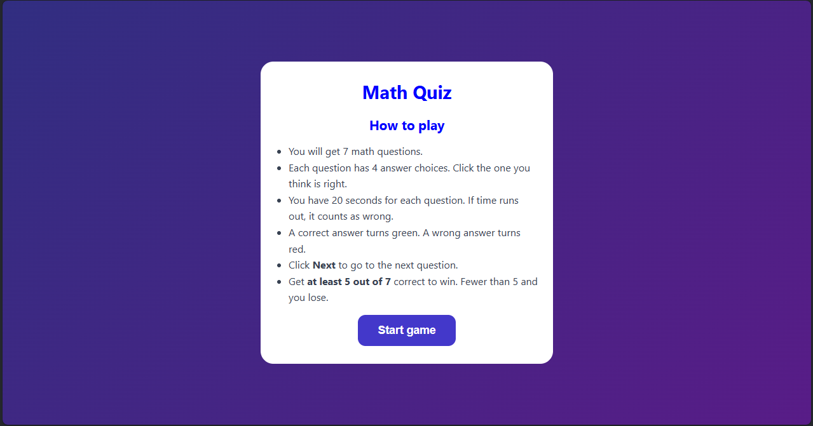

# Math Quiz

## About the game

Math Quiz is a browser game with 7 multiple-choices math questions.
Each questions has 4 answer choices in a random order and you have a timer 20 second.
A correct Answer turns green and the wrong answer turns red.

*Win*: answer at least 5 of the 7 questions.
*lose*: answer less than 5 questions and if the timer runs out, the question counts as wrong.

At the end the game show the results (Win or Lose). Also, the score and a review of every question.

I chose math quiz because I think most of you don't really like math. So, I thought these questions might make it more interesting. 

## Getting started

*Play the game*: [Math Quiz](http://127.0.0.1:5500/index.html)

How to play: 
1. Click *Start game*.
2. Click the answer you think is correct before 20 seconds run out.
3. Click *next* to go to the next question.
4. Get at least 5 out of 7 correct to win.

## Planning

## Backlog

1. As a player, I want to read the game instructions, so that I know how to play and how to win.
2. As a player, I want to click a Start button, so that I can begin the game when I am ready.
3. As a player, I want to see one math question at a time, so that I can focus on each question.
4. As a player, I want to choose from 4 answer choices, so that I can pick the answer I think is right.
5. As a player, I want the answer choices in a different order each time, so that the game stays interesting when I play again.
6. As a player, I want to see right away if my answer is correct (green) or wrong (red), so that I can learn from my mistakes.
7. As a player, I want a 20-second timer for each question, so that the game is more challenging.
8. As a player, I want to see my score, the question number and a progress bar, so that I know how well I am doing.
9. As a player, I want to see a "You win" or "You lose" message at the end, so that I know if I passed or not.
10. As a player, I want to review my answers and click Play again, so that I can see my mistakes and try to get a better score.

## Sprint goal

The player can answer all 7 questions before the timer runs out and see whether they won or lost.

## Technologies used 

1. HTML
2. CSS
3. JavaScript

##  Attributions

AI assistance (Gemini): understand some of codes in javaScript and timer.
AI assistance (Claude): help in last code in CSS (hidden).

## Next steps

1. Add more questions.
2. add difficulty levels (easy, normal, hard, impossible).
3. Save a high score.
4. Shuffle the order of the questions.
